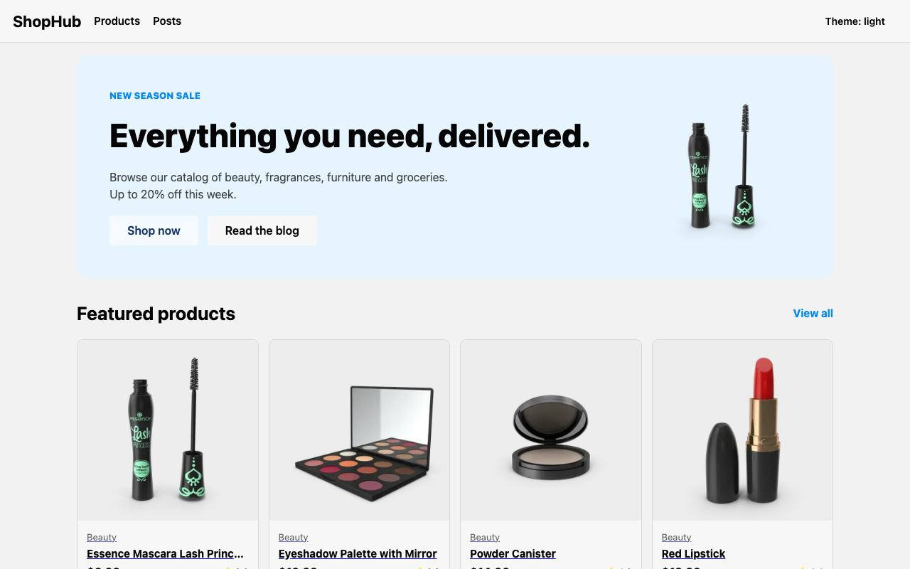
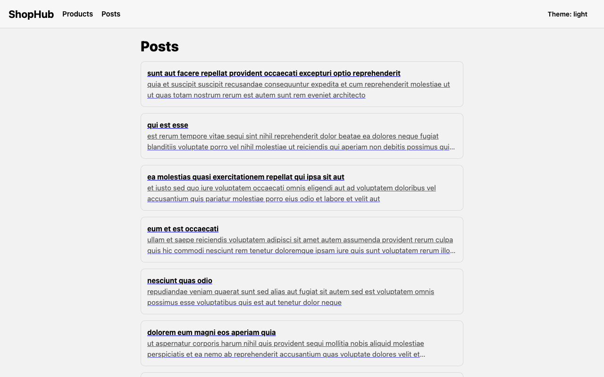
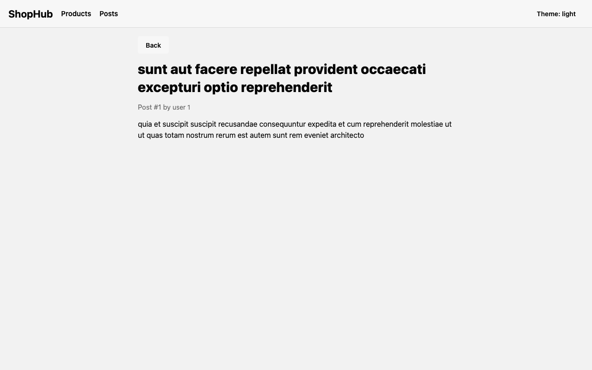
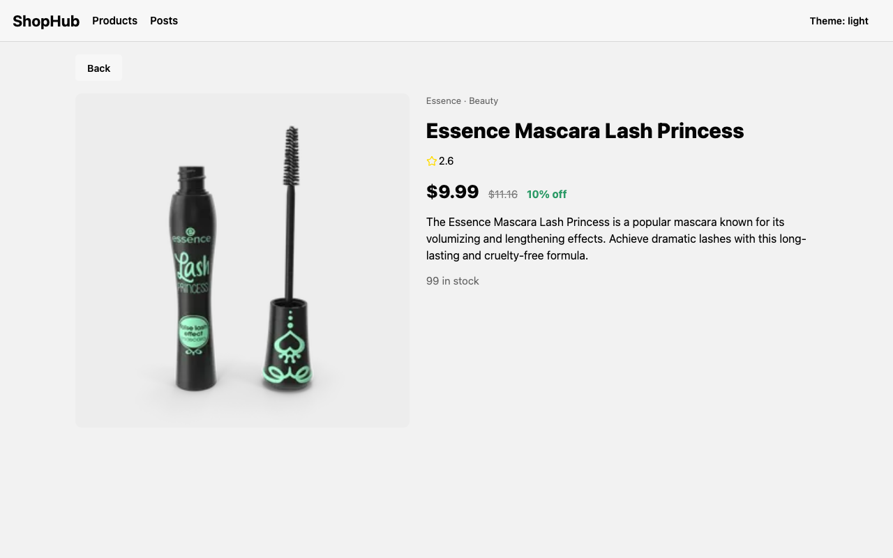
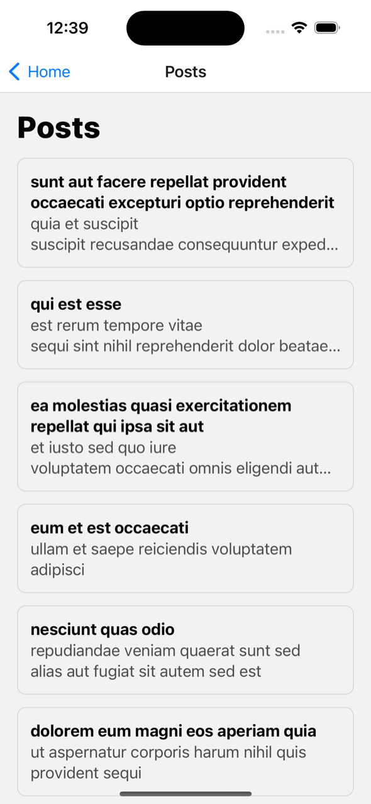
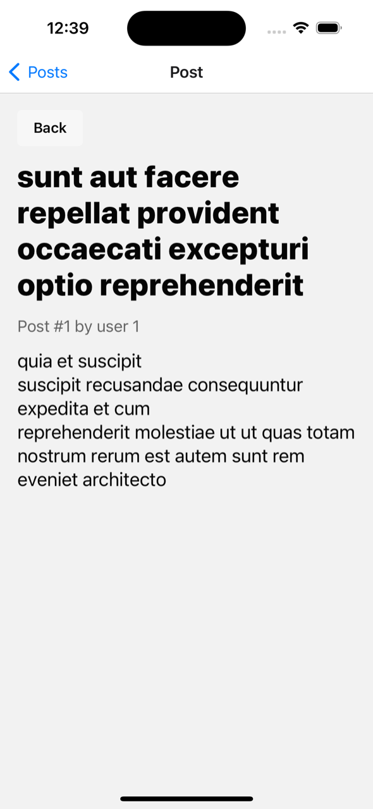
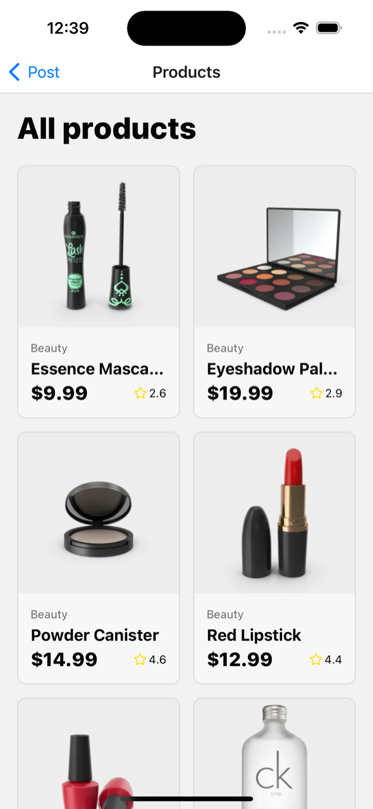
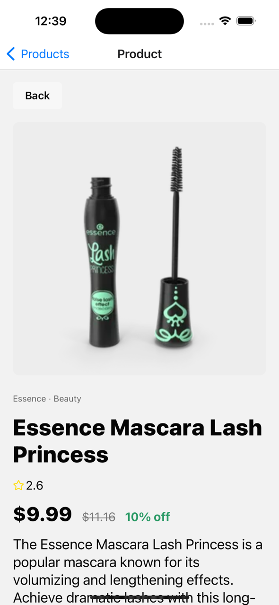

# Posts App (ShopHub), Expo Router pilot

One shared UI and feature codebase, rendered by a **single Expo Router app** on web, iOS and Android. It shows posts from [JSONPlaceholder](https://jsonplaceholder.typicode.com) and a product catalog from [DummyJSON](https://dummyjson.com).

This is a pilot, not production code. It rebuilds the Next.js + Solito + Tamagui reference app (`~/Documents/vsCodeProjects/posts-app`) on Expo Router only, so the two stacks can be compared. Measured results are in [`docs/pilot-report.md`](docs/pilot-report.md).

## Screenshots

### Web (Expo Router, 1280×800)

| Home | Posts |
| --- | --- |
|  |  |
| **Post detail** | **Products** |
|  |  |
| **Product detail** | |
|  | |

Captured from the production export served by `expo serve`.

### iOS (Expo Go 58.0.7, iPhone 15 Pro simulator)

| Posts | Post detail | Products | Product detail |
| --- | --- | --- | --- |
|  |  |  |  |

The same screen components render on every platform. Web adds a custom header (`components/site-header.tsx`), and native uses the Stack header.

## Tech stack

| Layer | Choice | Version |
| --- | --- | --- |
| Framework (web and native) | Expo SDK + Expo Router, web `output: "server"` | 58.0.23 / 58.0.30 |
| UI / styling | Tamagui (`@tamagui/config/v5`) | 3.2.3 |
| Navigation | Expo Router only (no Solito, no second router) | 58.0.30 |
| Runtime | React / React Native / react-native-web | 19.3.0 / 0.88.1 / 0.21.4 |
| Language and tooling | TypeScript, Biome, Vitest, Playwright | 6.0 / 1.9 / 5.1 / 1.65 |
| Package manager | npm, single `package.json` (no monorepo) | n/a |

### How the pieces fit

- **`app/`** holds the routes (Expo Router file-based routing). One route tree serves all platforms.
- **Route files own data.** Each exports `loader` (via `createStaticLoader` from `expo-server`), `generateMetadata`, an `ErrorBoundary`, and a default component that reads `useLoaderData`.
- **Screens are presentational.** `features/<feature>/…-screen.tsx` take data as props. `features/<feature>/api.ts` run only inside loaders and `generateMetadata`, so the client bundle contains no API URL.
- **Web is server-rendered** with `expo export` + `expo serve`. Native calls the same loaders on the Expo server (the dev server in development).
- **`components/`** holds the header, theme, and generated icons (`npx @tamagui/cli icons add <Name>`). **`tamagui.config.ts`** is the Tamagui config.

## Pros and cons of this stack

Numbers come from single runs on one machine. See [`docs/pilot-report.md`](docs/pilot-report.md) for method and caveats.

### Pros

- **Everything is shared.** 100% of counted UI and feature lines are shared by file (807 / 807), 92.9% by runtime use. The reference is 81.4% and 55.9%. There is one route tree, so no web route, native route and native fetch wrapper per feature.
- **Very little glue.** No `metro.config.js`, `babel.config.js` or `next.config.js`, no aliases, shims, patches, `transpilePackages` or dependency `resolutions`. One `package.json` and one `tsconfig`, against 6 of each in the reference.
- **Real SSR and SEO on web.** With `web.output: "server"`, `/posts/[id]` and `/products/[id]` return HTML with the content, a per-page `<title>` and meta description, and a real HTTP 404 for a missing item. Lighthouse SEO is 100 on both apps.
- **Data loaders on web, no client-side fetch.** The API URL never reaches the browser bundle (`grep -rl "jsonplaceholder\|dummyjson" dist/client` finds nothing), and `API_BASE_URL` is read at request time.
- **Native-quality navigation.** Expo Router gives native stack navigation and deep links. `/user/[id]` is a modal on native and a normal page on web.
- **Faster rebuilds.** Production build with no changes took 4.9 s (reference 13.0 s), and after a one-line change 4.3 s (12.9 s). Cold builds were similar (23.4 s vs 21.3 s).
- **Type errors are not hidden.** `tsc` is strict (`noUncheckedIndexedAccess`) and passes. The reference sets `typescript.ignoreBuildErrors: true`.
- **Newer, maintained base.** Expo SDK 58 is the first release where server rendering is stable, and `expo-doctor` passes 20/20.
- **Good guardrails.** Biome (`noExplicitAny` is an error here), Vitest, and Playwright against the production build.

### Cons

- **A production server is required.** `output: "server"` needs a Node or edge host (Expo Hosting, Express, Cloudflare, Vercel, Netlify or Bun adapters). Static and server output cannot be mixed in one project, and there is no ISR or tag-based cache invalidation (loaders only offer `Cache-Control` headers).
- **Native depends on the deployed server.** Native loaders call the Expo server, so a production native build needs it reachable. The reference's native app fetches the APIs directly.
- **Heavier client.** About 697 KB of compressed JS vs 302 KB (2.3x), and about 3x the Total Blocking Time (292-301 ms vs 85-126 ms). The pilot still paints earlier (FCP about 930 ms vs 1,057 ms).
- **`expo serve` does not compress.** Behind no proxy, Lighthouse performance was 65-69 and JS was 2,701 KB. A real host or CDN would normally compress, but you must check yours.
- **The 404 body is plain text.** A loader that throws `StatusError(404)` returns the right status with a `text/plain` body, not the styled page. In `expo start` the same route returns 500.
- **Tamagui's Metro plugin breaks dev SSR.** `withTamagui` from `@tamagui/cli/metro` made every route after the first fail with `Requiring unknown module`. It is left out, so the Tamagui compiler is not used (cause not found, see gap 2 in the report).
- **Double upstream fetch on detail pages.** `generateMetadata` cannot see loader data, so each detail page calls the API twice per request until a per-request cache is added.
- **Tamagui 3 is a breaking upgrade.** Bare tokens, string clauses for media and state, `render` instead of `tag`, and no icon package. Porting from the reference's Tamagui 2 means rewriting the screens.
- **Extra generate step.** `tamagui generate-css` must run before dev and build, and the 700 KB output is gitignored.
- **Not evaluated:** Android, INP, real devices, load testing, the Tamagui compiler, and a static-output variant.

### Cons of the reference stack: solved here or not

Each row is a con from the reference README (`~/Documents/vsCodeProjects/posts-app`) and what happens in this pilot.

| Reference con | Status here | Details |
| --- | --- | --- |
| Starter is no longer maintained upstream (the `create tamagui` Next + Expo template points to Takeout) | **Solved** | No starter is used. The app comes from `create-expo-app` and follows Tamagui's current Expo guide, so there is no template to be abandoned. |
| Pre-release dependencies (Tamagui `2.0.0-rc.16`, pinned `resolutions`) | **Solved** | Tamagui is on stable `3.2.3` and Expo SDK 58 is the latest release. `package.json` has 0 dependency `resolutions`. |
| Two bundlers on web (Turbopack dev, webpack prod), aliases declared twice | **Solved** | Metro is the only bundler for dev and production, native and web. 0 aliases, no `next.config.js`, `metro.config.js` or `babel.config.js`. Dev and prod still differ in two ways, see below. |
| Workarounds in the glue (lazy plugin `require`, Solito patch, safe-area shim, `transpilePackages`) | **Mostly solved** | 0 shims, 0 patches, 0 `transpilePackages` (reference: 1 shim, 2 patches, 8 entries). Smaller workarounds remain: no `withTamagui` in Metro, `SuspenseFallback` cannot use Tamagui, generated CSS and icons. |
| Duplicated routing and data layers (web route, native route, native fetch wrapper per feature) | **Solved** | One route tree in `app/`. Each route has one `loader` that serves web and native, so there is no second fetch layer. 100% of counted code is shared by file (reference 81.4%). |
| Type errors do not fail the web build (`ignoreBuildErrors: true`) | **Solved** | There is no setting that hides errors, and strict `tsc --noEmit` passes. Type checking is still a separate step (`npm run typecheck`). I did not check whether `expo export` runs `tsc` itself. |
| Monorepo overhead (version matching, rebuilding `@my/ui` and `@my/config`, slow tests) | **Solved** | One `package.json`, one `tsconfig`, no workspace packages to rebuild. Vitest unit tests do not spawn a framework server. `npm run test:e2e` still builds and serves the production export (about 23 s cold build). |
| Native development friction (Expo Go must match the SDK, `expo-dev-client`) | **Not solved** | `expo-dev-client` is not installed, so `expo start --ios` uses Expo Go. But Expo Go must still match SDK 58. The simulator had SDK 54 and the app refused to open until Expo Go 58.0.7 was installed. The first `simctl openurl` can also time out while the simulator warms up. |

#### Still present or new in this pilot

These are not in the reference's cons list, or only partly:

- **Dev and production behave differently.** A missing item returns 404 in production but 500 in `expo start`. Tamagui's Metro plugin works in the production export but breaks dev SSR.
- **A production server is now required** (`web.output: "server"`), and native loaders depend on it. The reference's native app fetches the APIs directly.
- **Heavier client JS** (697 KB vs 302 KB compressed) and no Tamagui compiler, so the style extraction the reference gets from `yarn web:prod` is missing.
- **Plain-text 404 body** from a loader's `StatusError(404)`, where Next.js renders a styled page.
- **Tamagui 3 API break.** The reference's screens had to be ported (bare tokens, string clauses, `render` instead of `tag`, no icon package).
- **Extra step:** `tamagui generate-css` must run before dev and build.
- **Double upstream fetch** on detail pages, because `generateMetadata` cannot see loader data.

### When this stack is a good fit

You want one codebase and one router for web and native, and the web side is a content-heavy, request-time site that needs per-page metadata and correct 404 statuses. If you need ISR, mixed static and dynamic routes, a styled 404 from dynamic routes, or the smallest possible client, plan on Next.js for web. See [`docs/pilot-report.md`](docs/pilot-report.md) for the full comparison.

## Project layout

```
app/             Expo Router routes (loader, generateMetadata, ErrorBoundary per route)
  posts/ products/ user/
features/        home, posts, products, user, shared (screens and api.ts)
components/      site-header, theme, generated icons
e2e/             Playwright specs (run against the production build)
tests/           Vitest unit tests
scripts/         check-html.sh (status, title, description of every route)
docs/            pilot-report.md
```

Organize new code by feature under `features/<feature>/`. Screens take data as props, and only route files fetch.

## Getting started

Requirements: Node and npm. Measured on Node v26.0.0 (Apple Silicon Mac).

```sh
npm install        # install
npm run web        # web dev server (runs tamagui generate-css first)
npm start          # Expo dev server (Metro on :8081)
npm run ios        # iOS simulator (needs Xcode)
npm run android    # Android (not run in the pilot)
```

| Command | What it does |
| --- | --- |
| `npm run build:web` | `expo export --platform web` into `dist/` (`dist/client` + `dist/server`) |
| `npm run serve:web` | `expo serve` runs the exported server (default port 8081, use `--port`) |
| `npm run css` | `tamagui generate-css`, required before dev and build |
| `npm test` | Vitest unit tests |
| `npm run test:e2e` | Playwright against the production build (builds and serves on port 3100 unless one is running) |
| `npm run typecheck` | `tsc --noEmit` |
| `npm run lint` / `npm run format` | Biome check / format |
| `scripts/check-html.sh [base-url]` | Curl every route and print status, `<title>`, description, and whether the content is in the raw HTML |

### Environment

`API_BASE_URL` (optional) overrides the posts API base URL, which defaults to JSONPlaceholder. `PRODUCTS_API_BASE_URL` does the same for products and defaults to DummyJSON. Both are server-only (no `EXPO_PUBLIC_` prefix), read at request time, and never reach the client bundle. See `.env.example`.

### Running on iOS simulator

```sh
npm run ios
```

The first `simctl openurl` can time out while the simulator warms up. Retry if it does. In Expo Go, cold-start deep links only open the project home.

## Adding dependencies

- Install with `npx expo install <pkg>` so versions match the SDK.
- Add Tamagui icons with `npx @tamagui/cli icons add <Name>` (Tamagui 3 ships no icon package).
- Do not re-add `withTamagui` in a `metro.config.js` without retesting `expo start --web`.

## Deploying

Not deployed. Web needs a Node or edge host for `dist/server`, and a production native build needs that same server deployed and reachable. Do not deploy or push anywhere without asking the owner.
